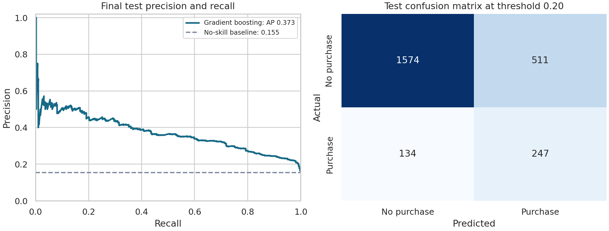
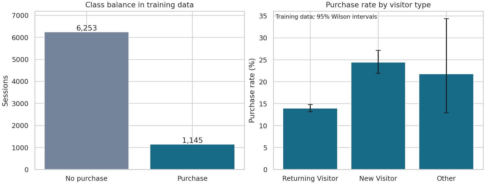
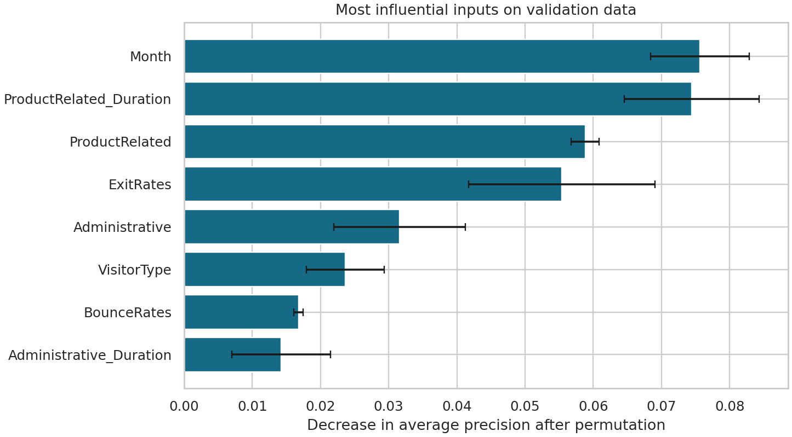

# Session Conversion Analysis Results

## Question

Can the supplied session attributes distinguish sessions that ended in a purchase? This is an offline classification study, not a live pre-checkout system.

## Data and preparation

The public UCI dataset contains 12,330 sessions. The file has 0 missing cells and 125 exact duplicate rows. Repeated predictor rows are retained and kept together across all partitions and cross-validation folds.

PageValues is omitted because its transaction-linked definition creates a potential information-availability concern. This is a conservative design choice, not proof that the original column is leaked. Four row-level features describe total pages, duration, seconds per page and product-page share. Imputation, scaling and encoding are learned within each training fold.

| Partition | Sessions | Purchases | Purchase rate |
|---|---:|---:|---:|
| train | 7,398 | 1,145 | 15.48% |
| validation | 2,466 | 382 | 15.49% |
| test | 2,466 | 381 | 15.45% |

## Training model comparison

All comparisons use three folds inside the training partition. The same folds are used for every candidate; average precision is the preselected ranking metric.

| Model | Mean CV average precision | Fold standard deviation | Mean CV ROC-AUC |
|---|---:|---:|---:|
| Gradient boosting | 0.3439 | 0.0131 | 0.7644 |
| Logistic regression | 0.3084 | 0.0069 | 0.7407 |
| Dummy baseline | 0.1548 | 0.0002 | 0.5000 |

## Final test evaluation

Selected model: **Gradient boosting**. The threshold **0.20** was chosen using validation F1 before inspecting the test scores. The model remains fitted on training rows only; it is not refitted after threshold selection.

| Metric | Test result |
|---|---:|
| roc auc | 0.7851 |
| average precision | 0.3726 |
| precision | 0.3259 |
| recall | 0.6483 |
| f1 | 0.4337 |
| accuracy | 0.7384 |
| No-skill average precision | 0.1545 |

## Exploratory statistics

Visitor-type purchase rates use training data only and include Wilson confidence intervals. A chi-square test describes association; it does not establish causation. These intervals assume independent sessions and may be optimistic if repeated feature rows reflect correlated observations.

Chi-square = 75.371; degrees of freedom = 2; p = 4.3e-17; minimum expected count = 8.51.

## Limits

The source is a historical, single-site dataset. A grouped random split does not prove performance on a later period, another site or live events. Session-level aggregates are not a timestamped event stream. The output scores are not calibrated probabilities. There is no claimed revenue lift, deployment, experiment on real customers, or research-paper replication. Correlated features can share permutation importance, and importance is not causal.

## Reproducibility

Seed: 42. CSV SHA-256: `b3055ee355f59134d851d32641183cb4a8b45def7124d2f50442a042f358e0d9`. Exact package versions are recorded in `metrics.json`. Run `python run_project.py` and `python verify_project.py` from the project folder.

## Source

Sakar, C. and Kastro, Y. (2018). Online Shoppers Purchasing Intention Dataset. UCI Machine Learning Repository. https://doi.org/10.24432/C5F88Q . Dataset license: CC BY 4.0. See `../DATA_SOURCE.md`.
